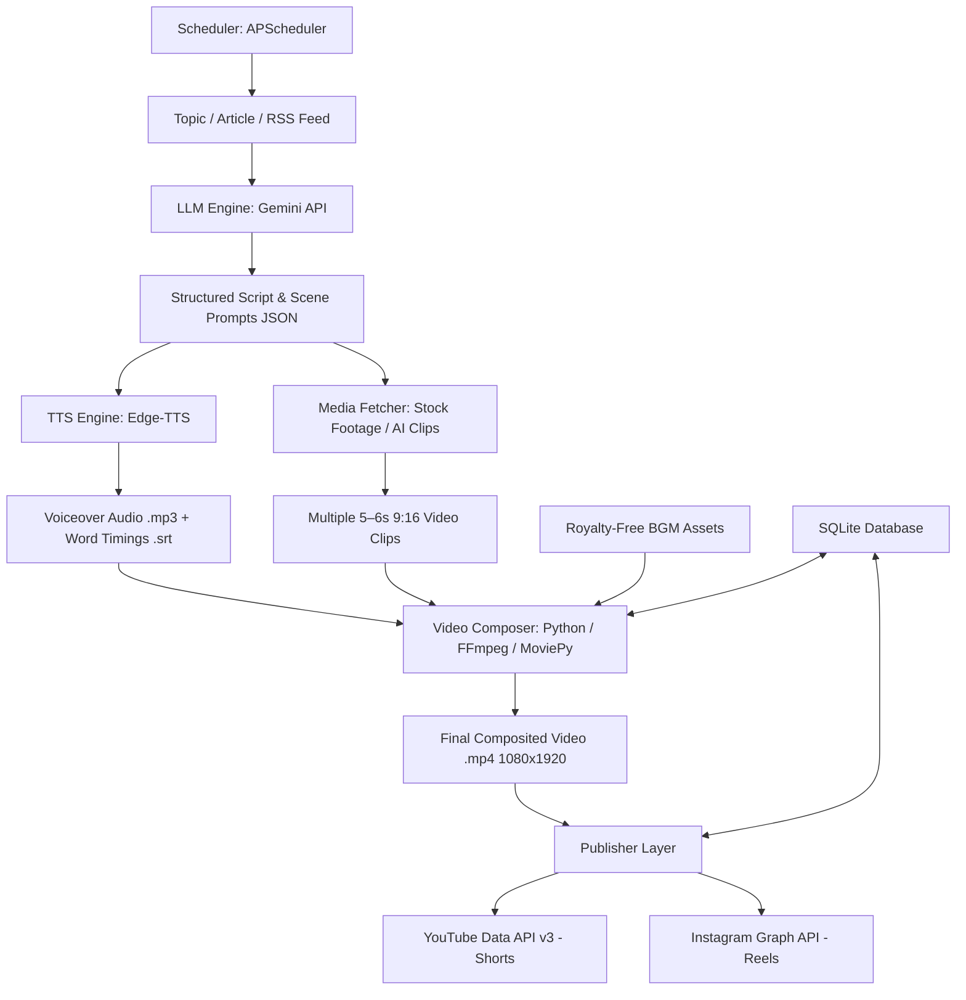

# AI Video Content Generation & Automated Publishing Pipeline
## Implementation Plan

---

## 1. Executive Summary & Objective

This project builds an automated end-to-end pipeline that takes a **topic or article**, generates a viral-ready short-form video script with scene prompts using **Google Gemini**, synthesizes human-like voiceover using **Edge-TTS**, fetches and prepares 5–6s visual clips (stock footage via Pexels/Pixabay and AI generation), composites a 30–60s 9:16 vertical video with animated captions and background music using **FFmpeg & MoviePy**, and publishes the final video to **YouTube Shorts** and **Instagram Reels** on a set schedule.

The design is inspired by the modular architecture of [ArmanShirzad/SocialMediaContentCreationAndPostingAutomationPlatform](https://github.com/ArmanShirzad/SocialMediaContentCreationAndPostingAutomationPlatform) and customized to fulfill the workflow specified in `pipeline.txt`.

---

## 2. Pipeline Workflow Architecture



---

## 3. Technology Stack

| Layer | Technology | Rationale / Details |
| :--- | :--- | :--- |
| **Runtime & Language** | Python 3.12 | Cross-platform, fast prototyping, extensive media processing libraries |
| **LLM Reasoning & Scriptwriting** | Google Gemini (`google-generativeai` / `google-genai`) | High speed, structured JSON output mode, large context window |
| **Voiceover Synthesis (TTS)** | `edge-tts` / `gTTS` | Ultra-realistic Microsoft Neural TTS voices, free, no API key required, zero latency |
| **Subtitles & Word Timing** | Edge-TTS VTT/SRT timing parser | Generates exact word-level / sentence-level timestamps for animated captions |
| **Visual Asset Sourcing** | Pexels Video API / Pixabay API | High quality, royalty-free HD 9:16 vertical clips matching scene keywords |
| **Video Processing & Assembly** | `FFmpeg` (binary) & `MoviePy` | Hardware-accelerated stitching, audio ducking, subtitle overlay, color grading |
| **Database & History** | SQLite (`sqlite3`) | Lightweight tracking of generated topics, video files, hashes, and upload status |
| **Publishing APIs** | YouTube Data API v3, Instagram Graph API / `instagrapi` | Official social media publication protocols |
| **Automation & Scheduling** | `APScheduler` | Scheduled recurring runs (e.g., daily at 10:00 and 18:00) |

---

## 4. API Keys, Credentials & Provisioning Guide

| Key / Credential | Required? | Cost | Purpose | Where to Get |
| :--- | :--- | :--- | :--- | :--- |
| **`GEMINI_API_KEY`** | **Yes** *(Active)* | Free tier available | Viral scriptwriting, hooks, scene breakdown, and SEO tags | [Google AI Studio](https://aistudio.google.com/app/apikey) |
| **`PIXABAY_API_KEY`** | **Optional** *(Recommended)* | **100% Free** | Downloads real vertical 9:16 HD stock video clips matching scene prompts | [Pixabay API Docs](https://pixabay.com/api/docs/) (Instant) |
| **`PEXELS_API_KEY`** | Optional | 100% Free | Pexels stock video API *(Note: new key issuance temporarily paused)* | [Pexels API Portal](https://www.pexels.com/api/) |
| **`client_secret.json`** | Optional | **100% Free** | Direct auto-upload to **YouTube Shorts** via official Google API | [Google Cloud Console](https://console.cloud.google.com/) |
| **Voiceover (TTS)** | *No Key Needed* | **100% Free** | Microsoft Edge Neural voice synthesis & word timing | Built-in via `edge-tts` (Zero config) |
| **Instagram Credentials** | Optional | Free | Auto-uploading to **Instagram Reels** | Your Instagram account / Meta Graph API |

### Detailed Provisioning Steps

#### 1. Google Gemini API Key (`GEMINI_API_KEY`)
* **Purpose**: Drives `core/llm_engine.py` to draft high-engagement scripts and scene visual prompts.
* **How to Obtain**:
  1. Visit [Google AI Studio](https://aistudio.google.com/app/apikey).
  2. Sign in with your Google Account.
  3. Click **"Create API key"** and copy the generated token.
  4. Paste into `.env`: `GEMINI_API_KEY=your_key_here`.

#### 2. Pixabay Video API Key (`PIXABAY_API_KEY`) — Recommended Stock Video Source
* **Purpose**: Drives `core/media_fetcher.py` to download real portrait (9:16) HD stock video clips matching scene keywords. 
* **Why Pixabay**: Pexels has temporarily paused new API key registrations. Pixabay offers the exact same catalog of free HD vertical stock videos with instant key access. *(If left blank, the pipeline automatically falls back to generating AI visuals with Ken Burns zoom motion).*
* **How to Obtain (Instant - 30 seconds)**:
  1. Visit [https://pixabay.com/api/docs/](https://pixabay.com/api/docs/).
  2. Log in or create a free account.
  3. Under the **Search Videos** section, your personal API key is displayed directly in green text.
  4. Copy it and paste into `.env`:
     ```env
     PIXABAY_API_KEY=your_copied_key_here
     ```

#### 3. Pexels Video API Key (`PEXELS_API_KEY`)
* **Notice**: As of October 2026, Pexels displays *"New API key issuance is currently paused."* If you already have an existing Pexels key, it remains fully supported in `core/media_fetcher.py`. Otherwise, use Pixabay above or the zero-key AI generator.

#### 4. YouTube Shorts OAuth2 Credentials (`client_secret.json`)
* **Purpose**: Used by `publishers/youtube_publisher.py` to auto-upload generated `.mp4` videos directly to YouTube with automated `#Shorts` tagging.
* **How to Obtain**:
  1. Go to [Google Cloud Console](https://console.cloud.google.com/).
  2. Create a new project (e.g. *"YouTube Shorts Automation"*).
  3. Go to **APIs & Services > Library**, search for **YouTube Data API v3**, and click **Enable**.
  4. Go to **APIs & Services > OAuth consent screen**:
     - User Type: **External** -> Click **Create**.
     - Fill in App Name and your contact email.
     - Under **Test Users**, add your personal Google/YouTube email address.
  5. Go to **APIs & Services > Credentials**:
     - Click **+ CREATE CREDENTIALS** -> **OAuth client ID**.
     - Application type: Select **Desktop app**.
     - Click **Create**, then click **DOWNLOAD JSON**.
  6. Rename the file to `client_secret.json` and save it directly in the project root directory.

#### 5. Neural Text-To-Speech (No Key Required)
* **Purpose**: Generates crisp, realistic voiceovers (`en-US-ChristopherNeural` / `en-US-JennyNeural`) and millisecond-accurate word boundary subtitles.
* **Configuration**: Handled natively by Microsoft Edge Neural TTS with no keys or subscriptions required.

---

## 5. Directory & Module Structure

```text
ai_video_content_gen_pipeline/
├── config/
│   ├── __init__.py
│   ├── config.py                 # Loads .env, defines video dimensions (1080x1920), FPS, paths
│   └── prompts.py                # System instructions & Pydantic output schemas for Gemini
├── core/
│   ├── __init__.py
│   ├── llm_engine.py             # Scriptwriting, scene breakdown, title, description, hashtags
│   ├── tts_engine.py             # Edge-TTS voice generation and subtitle SRT/VTT generation
│   ├── media_fetcher.py          # Pexels API / stock video download and caching
│   ├── video_composer.py         # FFmpeg / MoviePy video stitcher, caption overlay & audio ducking
│   └── database.py               # SQLite schema & queries for tracking generation history
├── publishers/
│   ├── __init__.py
│   ├── youtube_publisher.py      # OAuth2 flow and video upload to YouTube Shorts
│   └── instagram_publisher.py    # Instagram Reels uploader
├── assets/
│   ├── music/                    # Background music tracks (royalty-free lofi/ambient/cinematic)
│   ├── fonts/                    # High-impact fonts for subtitles (e.g., Montserrat-Black.ttf)
│   └── overlays/                 # Vignettes, sound effects, or branding watermarks
├── output/                       # Output directory for renders, temp clips, and audio files
│   ├── temp/
│   └── final/
├── scheduler.py                  # Background cron/interval scheduler
├── main.py                       # CLI interface to run manual or automated jobs
├── requirements.txt              # Dependency specifications
├── env.example                   # Template for environment variables
└── IMPLEMENTATION_PLAN.md        # This implementation plan
```

---

## 6. Detailed Implementation Phases

### Phase 1: Environment Setup & Project Foundation
- [x] Initialize Python environment.
- [x] Create `requirements.txt` with core libraries.
- [x] Setup `config/config.py` and `.env` loading.
- [x] Verify local FFmpeg binary compatibility.

### Phase 2: LLM Script & Scene Generation Engine (`core/llm_engine.py`)
- [x] Define structured Pydantic schema in `config/prompts.py`.
- [x] Implement Gemini 3.8 Flash client with multi-model fallback resiliency.
- [x] Verified high-retention script, hook, and scene visual keyword generation.

### Phase 3: Voiceover & Synchronized Subtitles (`core/tts_engine.py`)
- [x] Integrate `edge-tts` with high-quality neural voices (`en-US-ChristopherNeural`).
- [x] Generate audio per scene with exact millisecond-accurate timestamps and SRT subtitle files.

### Phase 4: Visual Asset Sourcing (`core/media_fetcher.py`)
- [x] Integrate Pexels Video API for 9:16 portrait stock footage.
- [x] High-res AI visual generation fallback + smooth Ken Burns camera pan/zoom motion.

### Phase 5: Video Composition Engine (`core/video_composer.py`)
- [x] Normalize clips to 1080x1920 (9:16 vertical), 30 FPS.
- [x] Concat clips and voiceovers.
- [x] Mix ambient synth background music (auto-ducked to 12-15% under speech).
- [x] High-visibility animated captions burned into lower-third.
- [x] Render optimized MP4 (`libx264`, `aac`).

### Phase 6: Database & Duplicate Prevention (`core/database.py`)
- [x] Setup SQLite database `data/pipeline.db`.
- [x] Track topics, script, video path, duration, and upload statuses.
- [x] Automatic duplicate prevention.

### Phase 7: Social Media Publishing (`publishers/`)
- [x] **YouTube Shorts (`youtube_publisher.py`)**: OAuth2 flow and video uploader with `#Shorts` tagging.
- [ ] **Instagram Reels (`instagram_publisher.py`)**: Direct upload integration.

### Phase 8: Automation & CLI Controller (`main.py` & `scheduler.py`)
- [x] CLI controller `main.py` with `--topic`, `--force`, and `--publish-youtube` options.
- [x] Background scheduler `scheduler.py` with `topics.txt` queue.
- [ ] Implement `scheduler.py` using `APScheduler` for autonomous daily publishing.

---

## 7. Verification & Testing Milestones

| Milestone | Target Output | Success Criteria |
| :--- | :--- | :--- |
| **M1: Script Gen** | `test_script.json` | Gemini outputs valid JSON with hook, scenes, and narration |
| **M2: Voice & Timing** | `temp_audio.mp3` & `captions.srt` | Edge-TTS creates crisp audio and accurate subtitle timings |
| **M3: Stock Retrieval** | 4-5 `.mp4` video clips | Pexels API downloads 9:16 vertical clips matching scene keywords |
| **M4: Video Composition** | `output/final/short_001.mp4` | 30-45s vertical video with audio, music, and subtitles perfectly synced |
| **M5: Publishing Test** | Video live on YouTube / Instagram | Video uploaded as private/unlisted for verification |

---

## 8. Next Immediate Steps

1. Install project dependencies from `requirements.txt`.
2. Implement **`config/config.py`** and **`core/llm_engine.py`** to test Gemini script generation.
3. Implement **`core/tts_engine.py`** to test voiceover audio + subtitle generation.
4. Integrate **`core/media_fetcher.py`** and **`core/video_composer.py`** to produce the first completed video file.
