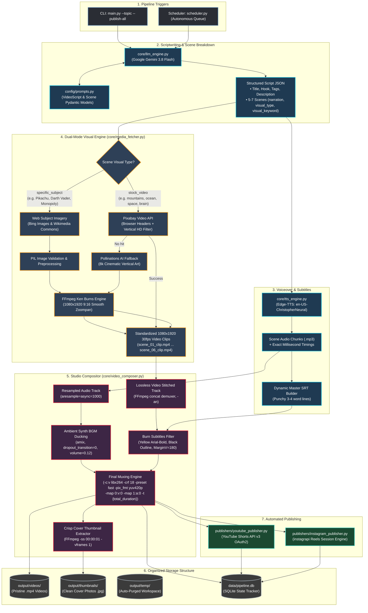
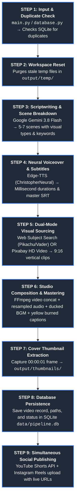
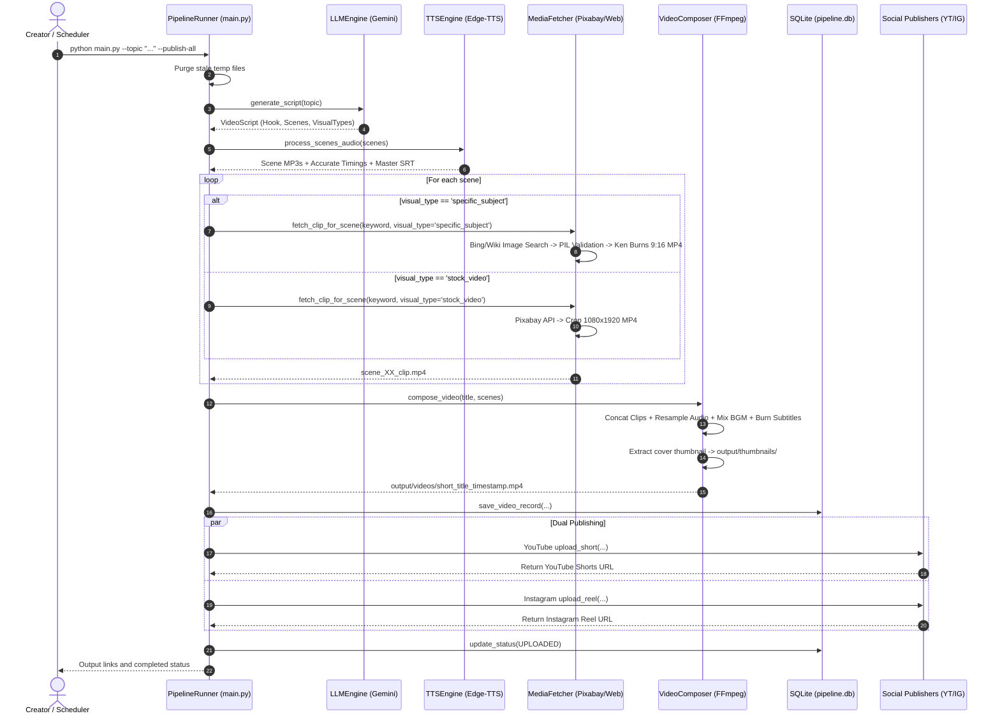

# 🎬 End-to-End Automated AI Video Generation & Publishing Pipeline

This document outlines the complete architectural schematic and operational workflow implemented in this repository.

---

## 📌 Vertical Sequential Pipeline (Overview)

```text
Topic
  ↓
LLM
  ↓
Script + Scene Prompts
  ↓
AI Video Generation
  ↓
Multiple 5–6 sec clips
  ↓
Python / FFmpeg
  ↓
30–60 sec video
  ↓
Voice + Music + Captions
  ↓
Final Video
  ↓
YouTube / Instagram API
  ↓
Scheduled Publishing
```

### Detailed Component Mapping

```text
Topic (CLI argument --topic or topics.txt queue)
  ↓
LLM (Google Gemini 3.8 Flash via core/llm_engine.py)
  ↓
Script + Scene Prompts (Hook, 5-7 Scene Narrations, Visual Keywords in config/prompts.py)
  ↓
AI Video Generation (Dual-Mode: Pixabay HD Video + Web Subject Imagery in core/media_fetcher.py)
  ↓
Multiple 5–6 sec clips (Normalized 1080x1920 9:16 vertical clips with Ken Burns motion)
  ↓
Python / FFmpeg (Lossless clip concatenation in core/video_composer.py)
  ↓
30–60 sec video (Full stitched video track)
  ↓
Voice + Music + Captions (Edge-TTS voiceover + ducked BGM + yellow burned subtitles)
  ↓
Final Video (High-quality output in output/videos/short_*.mp4)
  ↓
YouTube / Instagram API (OAuth2 Shorts API + instagrapi Reels API)
  ↓
Scheduled Publishing (Autonomous background loop via scheduler.py)
```

---

## 1. High-Level Pipeline Architecture (Schematic Flowchart)



---

## 2. Linear Sequential Pipeline (Step-by-Step Reference)

A direct, linear reference of the sequential execution flow executed during every pipeline run:



### Sequential Execution Reference Table

| Step # | Stage Name | Responsible File | Input(s) | Execution / Transformation | Output Artifact(s) |
|---|---|---|---|---|---|
| **Step 1** | **Topic Intake & Duplicate Check** | [main.py](file:///c:/Users/BIT/Downloads/ai_video_content_gen_pipeline/main.py) & [core/database.py](file:///c:/Users/BIT/Downloads/ai_video_content_gen_pipeline/core/database.py) | `--topic "..."`, `--force` | Queries SQLite table `videos` to prevent accidental duplicate video re-renders. | Validated topic string |
| **Step 2** | **Workspace Purge** | [main.py](file:///c:/Users/BIT/Downloads/ai_video_content_gen_pipeline/main.py) (`_clean_temp_dir`) | [output/temp/](file:///c:/Users/BIT/Downloads/ai_video_content_gen_pipeline/output/temp/) | Deletes residual audio/video slices and test artifacts from prior runs to ensure zero disk bloat. | Clean `output/temp/` directory |
| **Step 3** | **Scriptwriting & Scene Breakdown** | [core/llm_engine.py](file:///c:/Users/BIT/Downloads/ai_video_content_gen_pipeline/core/llm_engine.py) | Topic prompt + [config/prompts.py](file:///c:/Users/BIT/Downloads/ai_video_content_gen_pipeline/config/prompts.py) | Calls Google Gemini 3.8 Flash (`temperature=0.7`, structured JSON schema) to generate viral hook and 5–7 scenes. | [output/temp/last_generated_script.json](file:///c:/Users/BIT/Downloads/ai_video_content_gen_pipeline/output/temp/last_generated_script.json) |
| **Step 4** | **Neural Voiceover & SRT Timings** | [core/tts_engine.py](file:///c:/Users/BIT/Downloads/ai_video_content_gen_pipeline/core/tts_engine.py) | `script.scenes` | Synthesizes each scene using Edge-TTS (`en-US-ChristopherNeural`), extracting exact millisecond durations and word timestamps. | `scene_01_audio.mp3` ... `scene_06_audio.mp3`, `master_subtitles.srt` |
| **Step 5** | **Dual-Mode Visual Retrieval** | [core/media_fetcher.py](file:///c:/Users/BIT/Downloads/ai_video_content_gen_pipeline/core/media_fetcher.py) | `visual_type` & `visual_keyword` | • **Specific Subjects**: Bing Images / Wikimedia -> PIL verification -> 1080x1920 Ken Burns zoompan.<br/>• **Atmospheric**: Pixabay HD stock video API.<br/>• **Fallback**: Pollinations AI 8K art. | `scene_01_clip.mp4` ... `scene_06_clip.mp4` (all normalized to 1080x1920 @ 30fps) |
| **Step 6** | **Studio Composition & Mastering** | [core/video_composer.py](file:///c:/Users/BIT/Downloads/ai_video_content_gen_pipeline/core/video_composer.py) | Video clips + scene audios + BGM + `master_subtitles.srt` | 1. Video concat (`-an`).<br/>2. Audio concat with resampling (`aresample=async=1000`).<br/>3. BGM mix with auto-ducking to 12% (`dropout_transition=0`).<br/>4. Burn yellow/black subtitles at `MarginV=180`.<br/>5. Final render with `-crf 18 -t {exact_duration}`. | [output/videos/short_*.mp4](file:///c:/Users/BIT/Downloads/ai_video_content_gen_pipeline/output/videos) |
| **Step 7** | **Cover Thumbnail Extraction** | [core/video_composer.py](file:///c:/Users/BIT/Downloads/ai_video_content_gen_pipeline/core/video_composer.py) | Rendered MP4 | Captures frame at `00:00:01` with `-vframes 1 -q:v 2` and saves directly to thumbnails directory. | [output/thumbnails/short_*.jpg](file:///c:/Users/BIT/Downloads/ai_video_content_gen_pipeline/output/thumbnails) |
| **Step 8** | **Database Record Creation** | [core/database.py](file:///c:/Users/BIT/Downloads/ai_video_content_gen_pipeline/core/database.py) | Metadata (title, description, tags, path, duration) | Writes persistent record into `data/pipeline.db` with status `PENDING`. | Video Record ID in SQLite |
| **Step 9** | **Simultaneous Social Publishing** | [publishers/youtube_publisher.py](file:///c:/Users/BIT/Downloads/ai_video_content_gen_pipeline/publishers/youtube_publisher.py) & [publishers/instagram_publisher.py](file:///c:/Users/BIT/Downloads/ai_video_content_gen_pipeline/publishers/instagram_publisher.py) | Rendered video + thumbnail + metadata | • **YouTube**: OAuth2 upload tagged for Shorts shelf.<br/>• **Instagram**: Reels upload with session reuse; moves cover photos to `output/thumbnails/`.<br/>• Updates SQLite to `UPLOADED`. | Live Shorts URL & Instagram Reel URL |

---

## 3. Component-by-Component Breakdown

### 🧠 Stage 1: Intelligent Script Generation
* **Module**: [core/llm_engine.py](file:///c:/Users/BIT/Downloads/ai_video_content_gen_pipeline/core/llm_engine.py)
* **Model**: Google Gemini (`gemini-3.8-flash` with automatic fallback to `gemini-2.5-flash-lite` on quota spikes).
* **Schema**: [config/prompts.py](file:///c:/Users/BIT/Downloads/ai_video_content_gen_pipeline/config/prompts.py) (`VideoScript` & `Scene` Pydantic models).
* **Key Features**:
  * Formulates a 0–3s retention hook that prevents users from swiping.
  * Generates 5–7 scenes with target reading durations (4.0s–6.0s each).
  * Automatically classifies `visual_type` into:
    * `specific_subject`: Real character names (e.g. *Pikachu Pokemon*, *Darth Vader Star Wars*, *Monopoly Man*).
    * `stock_video`: Atmospheric physical search terms (e.g. *deep ocean diver*, *glowing neural brain*).

---

### 🎙️ Stage 2: Neural Voiceover & Subtitle Timing
* **Module**: [core/tts_engine.py](file:///c:/Users/BIT/Downloads/ai_video_content_gen_pipeline/core/tts_engine.py)
* **Voice**: Microsoft Edge-TTS (`en-US-AvaMultilingualNeural` with `+3%` cadence).
* **Millisecond Word Boundaries**: Captures exact word-level start and end timestamps directly from Microsoft TTS engine via `boundary="WordBoundary"`.
* **Zero Em Dashes**: Automatically sanitizes em dashes (`—`), en dashes (`–`), and horizontal bars into natural pauses and clean commas.

---

### 🎥 Stage 3: Tri-Mode Semantic Visual Engine
* **Module**: [core/media_fetcher.py](file:///c:/Users/BIT/Downloads/ai_video_content_gen_pipeline/core/media_fetcher.py)
* **Specific Subjects (Maps, Diagrams, Historical Entities, Logos, Celebrities)**:
  * Queries official Wikipedia Summary REST API and Wikimedia Commons file database for authentic high-resolution imagery.
  * Validates image headers and pixel buffers using PIL.
  * **Aspect-Adaptive Studio Rendering**:
    - For native 9:16 vertical images: Applies smooth cinematic slow zoom.
    - For 16:9 landscape / square images: Renders a CapCut/TikTok dual-layer blurred ambient background with a centered, un-cropped foreground framed by a clean studio border. Zero cropped heads, bodies, or maps.
* **Atmospheric & Cinematic B-Roll (Stock Video)**:
  * Queries Pixabay Video API with 1-2 word concrete nouns.
  * **Semantic Tag Validation**: Inspects each video's metadata tags, instantly rejecting blacklisted collisions (e.g. drifting cars for geology queries).
  * Crops and normalizes verified videos to 1080x1920 @ 30 FPS.
* **AI Generation Fallback & Sci-Fi Scenes**:
  * Slices high-detail 8K prompts into Pollinations AI if no stock or web footage exists.

---

### 🎞️ Stage 4: Composition & Audio Mastering
* **Module**: [core/video_composer.py](file:///c:/Users/BIT/Downloads/ai_video_content_gen_pipeline/core/video_composer.py)
* **Video Encoding**: Pristine H.264 vertical video (`-crf 18`, `-preset fast`, `-pix_fmt yuv420p`).
* **Audio Resampling & Continuous Playback**:
  * Uses `-af aresample=async=1000` to eliminate packet drift across scenes.
  * Loops ambient background music bed ducked to `12%` volume (`dropout_transition=0`).
  * Employs explicit stream mapping (`-map 0:v:0 -map 1:a:0 -t {total_duration}`) guaranteeing **continuous speech and music all the way to the final millisecond**.
* **Viral Creator Subtitle Styling**:
  * Bound to native `PlayResX=1080,PlayResY=1920` canvas.
  * **Typography**: `Arial Black`, Size 64 with bold styling and subtle letter spacing.
  * **Color & Contrast**: High-visibility warm gold/yellow (`&H0000F5FF`) with 4.5px deep black outline (`&H00000000`) and 2.0px soft drop shadow.
  * **Placement**: Eye-level center-aligned (`Alignment=2, MarginV=720, MarginL=80, MarginR=80`), completely safe from YouTube Shorts / Reels bottom soundbars, descriptions, and right-hand engagement icons.
  * **Balanced Chunking**: 2–3 words per line distributed evenly to eliminate awkward single-word orphan flashes.

---

### 🚀 Stage 5: Dual Social Publishing
* **YouTube Shorts**: [publishers/youtube_publisher.py](file:///c:/Users/BIT/Downloads/ai_video_content_gen_pipeline/publishers/youtube_publisher.py)
  * OAuth2 authenticated via `client_secret.json`.
  * Injects `#Shorts` tags into title and description for automatic Shorts shelf indexing.
* **Instagram Reels**: [publishers/instagram_publisher.py](file:///c:/Users/BIT/Downloads/ai_video_content_gen_pipeline/publishers/instagram_publisher.py)
  * Session-cached via `instagram_session.json` to avoid challenge checkpoints.
  * Automatically isolates upload thumbnail artifacts into `output/thumbnails/`.

---

### 📂 Stage 6: Organized Output Structure
```
output/
├── 🎬 videos/         # Pristine .mp4 video files (ready to view & share)
├── 🖼️ thumbnails/     # Clean cover photos & thumbnail assets (.jpg)
└── ⚙️ temp/           # Ephemeral workspace (auto-purged before every run)
```

---

## 3. Data Flow Sequence Diagram


