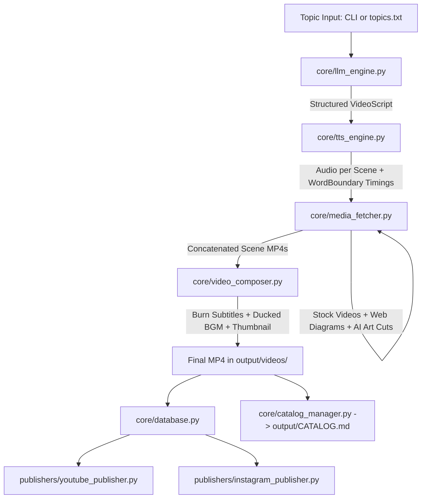

# 🎬 AI Video Content Generation Pipeline: Developer Onboarding & Architecture Guide

Welcome to the **AI Video Content Generation Pipeline** codebase. This document serves as the comprehensive architectural reference and file directory map for developers joining the project.

---

## 🌟 1. Project High-Level Mission

This repository contains an **autonomous, end-to-end production pipeline** for vertical short-form video content (**YouTube Shorts** and **Instagram Reels**). 

Given a single high-level topic (e.g., *"The underwater waterfall hiding in the Indian Ocean"*), the pipeline automatically:
1. Researches and scripts high-retention narration with Gemini 2.5 Flash.
2. Synthesizes voiceover with Microsoft Edge-TTS while capturing millisecond-accurate word boundaries.
3. Sources verified stock video, authentic historical/scientific diagrams, and generates bespoke 8K cinematic AI art—switching visual cuts every **2 to 3 seconds**.
4. Renders 1080x1920 vertical video with center-aligned bold captions and ducked background music.
5. Records the video in SQLite and publishes it to YouTube Shorts and Instagram Reels.
6. Organizes the output directory and updates an interactive catalog.

---

## 🚀 2. System Evolution & Key Improvements

Over successive development iterations, the pipeline was transformed from a prototype into an automated production studio. Below is a detailed breakdown of the technical problems encountered and the solutions engineered:

### 🎙️ A. Voice & Speech Synthesis
* **Previous State**: Monotone or robotic text-to-speech with fixed, un-synced line durations.
* **Improvements Made**:
  1. **Neural Voice Switch**: Standardized on Microsoft Edge's **`en-US-AvaMultilingualNeural`** (a warm, conversational female voice) with a fallback to `en-US-EmmaMultilingualNeural`.
  2. **Short-Form Speed Tuning**: Applied a `+3%` speech rate for an energetic, engaging tempo suited for YouTube Shorts without sounding rushed.
  3. **Millisecond-Level Word Boundary Tracking**: Switched Edge-TTS execution to capture raw `WordBoundary` events (`boundary="WordBoundary"`). The system now records the exact start and end offset in milliseconds for every single word spoken.

### 💬 B. Captions & Subtitle Styling
* **Previous State**: Bottom-anchored or off-center subtitles, long awkward text lines, flickering transitions, and punctuation pauses caused by em dashes.
* **Improvements Made**:
  1. **Center-Screen Alignment**: Configured FFmpeg subtitle force styling (`Alignment=2`, `MarginV=880`, `PlayResX=1080,PlayResY=1920`) placing captions directly in the optimal high-retention eye-line zone.
  2. **High-Contrast Creator Typography**: Styled with bold **`Arial Black`** (font size 64), vibrant creator yellow primary fill (`#FFFF00`), thick black outline (`Outline=5`), and drop shadow (`Shadow=2`).
  3. **Balanced Word Chunking**: Implemented dynamic 2–3 word grouping. Instead of showing full sentences, subtitles flash in rapid 2–3 word bursts synchronized to the voice, with orphan-line elimination.
  4. **Strict Zero Em-Dash Policy**: Programmatically sanitized all em dashes (`—`), en dashes (`–`), and double hyphens across the LLM prompt, the LLM engine post-processor, and the TTS synthesizer. This eliminates weird punctuation marks on screen and removes awkward voice pauses.
  5. **Micro-Gap Smoothing**: Caption gaps under 0.35s between consecutive words are automatically bridged to eliminate subtitle flicker.

### 🎵 C. Background Music (BGM) & Audio Mastering
* **Previous State**: A synthetic 110Hz raw sine-wave tone or inaudible background audio.
* **Improvements Made**:
  1. **Royalty-Free Audio Library**: Replaced synthetic test tones with curated, copyright-safe tracks in `assets/music/`:
     * `suspense_mystery.mp3` (*The Descent* by Kevin MacLeod) for cosmic, ocean, danger, and tech topics.
     * `playful_hook.mp3` (*Sneaky Snitch*) for psychology quirks and viral trivia.
     * `chill_aesthetic.mp3` (*Clean Soul*) for nature and travel.
  2. **Smart Mood Matching**: The composer inspects video titles and keywords to automatically pick the soundtrack matching the topic's emotion.
  3. **EBU R128 Loudness Normalization (`loudnorm`)**: Added an automatic normalizer (`loudnorm=I=-20:TP=-1.5:LRA=11`) so tracks with different recording levels play at a consistent baseline.
  4. **Creator-Standard Audio Ducking**: Narration remains at 100% volume (`volume=1.0`), while BGM is ducked at 22% volume (`BGM_VOLUME = 0.22`), providing clear musical rhythm without competing with speech.
  5. **Smooth Outro Fade & Non-Destructive Mix**: Added `afade=t=out:d=1.5` so music fades out naturally at the end of the video, and configured `amix` with `normalize=0` to prevent volume halving.

### 🎯 D. Visual Relevance & False-Positive Elimination
* **Previous State**: Keyword searches on Pixabay returned irrelevant videos (e.g. sports cars drifting for "continental drift" or motorcycle ads for geology). Web scrapers returned blank or low-res images.
* **Improvements Made**:
  1. **Semantic Tag Filtering (`_is_tag_relevant`)**: Inspects Pixabay tags and enforces a negative-keyword blacklist (e.g., rejecting car/racing/commercial tags on nature/science topics).
  2. **Wikipedia Summary REST API & Wikimedia Commons**: Direct integration with official Wikipedia endpoints (`api/rest_v1/page/summary` and Commons `gsrnamespace=6`). Retrieves authentic maps, diagrams, and historical photos (e.g. Zealandia continent map, Le Morne mountain).
  3. **Studio Canvas for Landscape/Square Images**: For non-vertical imagery, applies a dual-layer canvas (ambient blurred slow-zoom background + uncropped centered foreground), ensuring diagrams and subjects are never clipped.

### ⚡ E. Fast 2–3s Visual Pacing & Real Video + AI Art Fusion
* **Previous State**: Single clips stayed on screen for 5–7 seconds, causing viewer drop-off.
* **Improvements Made**:
  1. **Strict 2–3s Cut Engine**: Any scene longer than 2.9s is automatically divided into multiple $2.0\text{s} - 2.8\text{s}$ sub-clips. (e.g. a 43s video now contains 19 distinct visual cuts).
  2. **Dynamic Fusion Loop**: Cuts alternate between verified live-action footage (real ocean/aerials/diving) and bespoke 8K cinematic AI art:
     $$\text{Real Video} \longrightarrow \text{AI Art} \longrightarrow \text{Real Video} \longrightarrow \text{AI Art} \dots$$
  3. **Context-Rich AI Prompts**: Prompts combine search keywords with actual narration text and a unique seed, ensuring AI art depicts exactly what Ava is describing.
  4. **Zero-Watermark Cropping**: Automatically trims the bottom 4.5% margin of AI-generated images before motion rendering, cleanly eliminating vendor watermarks and logos.

### 📁 F. Output Management & Workspace Organization
* **Previous State**: Videos, thumbnails, and temp files were dumped in an unorganized flat directory.
* **Improvements Made**:
  1. **Structured Folders**: Separated into `output/latest/` (instant access), `output/videos/` (final master exports), `output/thumbnails/` (cover frames), `output/archive/` (development runs), and `output/temp/` (auto-cleaned).
  2. **Interactive Catalog (`output/CATALOG.md`)**: Automatically refreshed dashboard listing every video with title, topic, duration, clickable MP4 link, thumbnail preview, and live YouTube/Instagram URLs.
  3. **Automatic Scratch Cleanup**: Temporary scene chunks and audio files are wiped after every successful run, preventing disk bloat.

---

## 📂 3. Complete File & Directory Map

```
ai_video_content_gen_pipeline/
│
├── .env                              # Active environment variables (API keys, credentials)
├── .env.example                      # Template for required environment variables
├── requirements.txt                  # Python dependencies
├── main.py                           # Primary CLI orchestrator and execution entry point
├── scheduler.py                      # Autonomous background cron job / recurring queue worker
├── topics.txt                        # Topic backlog queue organized by viral category
│
├── config/                           # System configuration and prompt schemas
│   ├── config.py                     # Global constants, paths, volume levels, resolutions
│   ├── prompts.py                    # Pydantic schemas (VideoScript, Scene) and system prompts
│   └── credentials/                  # Secure backup folder for client secrets
│       └── client_secret_raw_backup.json
│
├── core/                             # Core engine modules
│   ├── llm_engine.py                 # Gemini LLM integration for scriptwriting
│   ├── tts_engine.py                 # Neural TTS synthesizer & word timestamp extractor
│   ├── media_fetcher.py              # Tri-mode visual engine (Stock, Web, AI Art + 2-3s slicing)
│   ├── video_composer.py             # FFmpeg compositor, subtitle burning, and BGM mixer
│   ├── database.py                   # SQLite database manager for tracking generated videos
│   └── catalog_manager.py            # Automatic generator of the output/CATALOG.md dashboard
│
├── publishers/                       # Social media publishing integrations
│   ├── youtube_publisher.py          # YouTube Data API v3 OAuth & Shorts uploader
│   └── instagram_publisher.py        # Instagram Reels uploader via instagrapi
│
├── assets/                           # Media assets and bundled resources
│   ├── music/                        # Curated royalty-free background music tracks
│   │   ├── suspense_mystery.mp3      # Cinematic suspense soundtrack (The Descent)
│   │   ├── playful_hook.mp3          # High-retention curiosity track (Sneaky Snitch)
│   │   └── chill_aesthetic.mp3       # Relaxed modern lo-fi beat (Clean Soul)
│   ├── fonts/                        # Custom font files for subtitles (optional)
│   └── images/                       # Branding assets and reference screenshots
│       └── reference_screenshot.jpeg
│
├── data/                             # Persistent runtime data
│   └── pipeline.db                   # SQLite database file
│
├── docs/                             # Documentation and workflow diagrams
│   └── pipeline_ascii_chart.txt      # Text-based ASCII dataflow diagram
│
├── output/                           # Output production directory
│   ├── latest/                       # Quick access to the most recently generated video
│   │   ├── latest_short.mp4
│   │   └── latest_thumbnail.jpg
│   ├── videos/                       # Final master exported .mp4 video files
│   ├── thumbnails/                   # High-res cover frames (.jpg) matching each video
│   ├── archive/                      # Historical developmental test runs
│   ├── temp/                         # Auto-cleaned intermediate workspace
│   └── CATALOG.md                    # Interactive markdown catalog with live links
│
├── client_secret.json                # Active Google OAuth client secrets for YouTube
├── youtube_token.json                # Cached YouTube OAuth user session token
└── instagram_session.json            # Cached Instagram mobile session settings
```

---

## 🛠️ 4. Detailed Responsibilities of Each Component

### Root Execution Scripts

#### [`main.py`](file:///c:/Users/BIT/Downloads/ai_video_content_gen_pipeline/main.py)
* **What it does**: The central pipeline controller. Ties together LLM scripting, voice synthesis, media fetching, FFmpeg composition, database logging, publishing, and catalog refresh.
* **Key Class**: `ContentGenerationPipeline`
* **Key Method**: `run(topic, publish_youtube=False, publish_instagram=False, force=False)`
* **CLI Arguments**:
  * `--topic "Topic Name"`: The video topic to create.
  * `--publish-youtube`: Upload to YouTube Shorts upon completion.
  * `--publish-instagram`: Upload to Instagram Reels upon completion.
  * `--publish-all`: Upload to both platforms.
  * `--privacy {public,unlisted,private}`: YouTube visibility (default: `unlisted`).
  * `--force`: Bypass database duplicate check to re-generate an existing topic.

#### [`scheduler.py`](file:///c:/Users/BIT/Downloads/ai_video_content_gen_pipeline/scheduler.py)
* **What it does**: Autonomous background worker using `APScheduler`. Pops topics one by one from `topics.txt`, generates videos on a schedule (e.g. every 6 hours), and optionally publishes them.
* **Key Functions**: `get_next_topic()`, `scheduled_job()`, `start_scheduler(interval_hours=6)`

#### [`topics.txt`](file:///c:/Users/BIT/Downloads/ai_video_content_gen_pipeline/topics.txt)
* **What it does**: Backlog of viral topic ideas organized across 9 high-performing categories: Extreme "What If", Cosmic Horrors, Bizarre Earth, Dark Psychology, and Sci-Fi Paradoxes.

---

### Core Engine (`core/`)

#### [`core/llm_engine.py`](file:///c:/Users/BIT/Downloads/ai_video_content_gen_pipeline/core/llm_engine.py)
* **What it does**: Interfaces with Google Gemini 2.5 Flash via `google-genai` SDK. Enforces structured JSON output validated against Pydantic schemas. Programmatically strips em dashes (`—`) to guarantee clean subtitle display and natural speech cadence.
* **Key Class**: `LLMEngine`
* **Key Method**: `generate_script(topic: str) -> VideoScript`

#### [`core/tts_engine.py`](file:///c:/Users/BIT/Downloads/ai_video_content_gen_pipeline/core/tts_engine.py)
* **What it does**: Converts script narration lines into speech using Microsoft Edge's neural TTS engine (`en-US-AvaMultilingualNeural`). Captures millisecond-level `WordBoundary` events to enable exact speech-to-subtitle synchronization.
* **Key Class**: `TTSEngine`
* **Key Methods**: `synthesize_scene()`, `process_scenes_audio()`

#### [`core/media_fetcher.py`](file:///c:/Users/BIT/Downloads/ai_video_content_gen_pipeline/core/media_fetcher.py)
* **What it does**: The Tri-Mode Visual Engine responsible for gathering high-quality 1080x1920 visuals.
  1. **Stock Video**: Pixabay and Pexels video APIs with strict negative keyword tag filtering (rejects false matches like drifting cars for continental drift).
  2. **Specific Subjects**: Wikipedia Summary REST API and Wikimedia Commons API for authentic maps, historical photos, and scientific diagrams.
  3. **Bespoke AI Art**: Pollinations AI (8K cinematic prompt synthesis tailored directly to narration context) with Ken Burns slow-zoom motion rendering and automatic bottom-watermark cropping.
  4. **Multi-Cut Slicing**: Slices scenes longer than 2.9s into multiple $2.0\text{s} - 2.8\text{s}$ sub-clips, alternating between real footage and AI art to maintain high viewer retention.
* **Key Class**: `MediaFetcher`
* **Key Methods**: `fetch_clip_for_scene()`, `_fetch_single_subclip()`, `_generate_ai_motion_clip()`, `_render_image_to_motion_clip()`

#### [`core/video_composer.py`](file:///c:/Users/BIT/Downloads/ai_video_content_gen_pipeline/core/video_composer.py)
* **What it does**: High-performance FFmpeg video composition engine:
  1. Stitches video clips with zero frame gaps.
  2. Builds master SRT subtitles grouped into balanced 2–3 word chunks using word cues.
  3. Burns centered, high-contrast subtitles (`Arial Black`, gold outline, no em dashes).
  4. Smart mood-based background music selection (`assets/music/`).
  5. EBU R128 `loudnorm` audio normalization with ducked BGM (22% volume) and a smooth 1.5s outro fade.
  6. Extracts high-res cover thumbnails to `output/thumbnails/`.
* **Key Class**: `VideoComposer`
* **Key Method**: `compose_video(title, scene_data)`

#### [`core/database.py`](file:///c:/Users/BIT/Downloads/ai_video_content_gen_pipeline/core/database.py)
* **What it does**: SQLite manager (`data/pipeline.db`). Stores video metadata, tags, durations, file paths, and publishing statuses (`PENDING`, `UPLOADED`, `FAILED`). Prevents duplicate runs for identical topics.
* **Key Class**: `Database`

#### [`core/catalog_manager.py`](file:///c:/Users/BIT/Downloads/ai_video_content_gen_pipeline/core/catalog_manager.py)
* **What it does**: Inspects database records and the `output/` directory to generate and refresh [`output/CATALOG.md`](file:///c:/Users/BIT/Downloads/ai_video_content_gen_pipeline/output/CATALOG.md).
* **Key Function**: `generate_catalog()`

---

### Configuration & Prompts (`config/`)

#### [`config/config.py`](file:///c:/Users/BIT/Downloads/ai_video_content_gen_pipeline/config/config.py)
* **What it does**: Single source of truth for runtime constants:
  * Resolutions: `VIDEO_WIDTH = 1080`, `VIDEO_HEIGHT = 1920`, `FPS = 30`
  * Volumes: `VOICE_VOLUME = 1.0`, `BGM_VOLUME = 0.22`
  * Voices: `DEFAULT_VOICE = "en-US-AvaMultilingualNeural"`
  * Font settings: `SUBTITLE_FONT = "Arial Black"`, `SUBTITLE_FONT_SIZE = 64`
  * Directory paths: `VIDEOS_DIR`, `THUMBNAILS_DIR`, `LATEST_DIR`, `ARCHIVE_DIR`, `TEMP_DIR`
  * Auto-locates the embedded FFmpeg binary.

#### [`config/prompts.py`](file:///c:/Users/BIT/Downloads/ai_video_content_gen_pipeline/config/prompts.py)
* **What it does**: Defines Pydantic data schemas:
  * `Scene`: Single atomic scene with narration, estimated duration, visual type (`stock_video`, `specific_subject`, `ai_art`), and visual search keywords.
  * `VideoScript`: Top-level schema containing title, description, tags, hook, list of scenes, and call to action.
  * `SCRIPT_SYSTEM_PROMPT`: Directs Gemini on viral pacing, zero-em-dash rule, and visual keyword rules.

---

### Social Media Publishers (`publishers/`)

#### [`publishers/youtube_publisher.py`](file:///c:/Users/BIT/Downloads/ai_video_content_gen_pipeline/publishers/youtube_publisher.py)
* **What it does**: Handles Google OAuth 2.0 authentication (`client_secret.json` -> `youtube_token.json`) and performs resumable uploads to YouTube Shorts with SEO tags and descriptions.
* **Key Class**: `YouTubePublisher`
* **Key Method**: `upload_short(video_path, title, description, tags, privacy_status)`

#### [`publishers/instagram_publisher.py`](file:///c:/Users/BIT/Downloads/ai_video_content_gen_pipeline/publishers/instagram_publisher.py)
* **What it does**: Automates Instagram Reel uploads using `instagrapi`. Uses cached mobile session files (`instagram_session.json`) with human-like delays to avoid login challenges.
* **Key Class**: `InstagramPublisher`
* **Key Method**: `upload_reel(video_path, caption)`

---

## 🔄 5. End-to-End Data Flow



---

## ⚡ 6. Developer Quickstart & Cheatsheet

### 1. Setup & Environment
```powershell
# Clone and enter directory
cd ai_video_content_gen_pipeline

# Install dependencies
pip install -r requirements.txt

# Configure .env
cp .env.example .env
# Open .env and fill in:
# GEMINI_API_KEY, PIXABAY_API_KEY, PEXELS_API_KEY (optional), INSTAGRAM credentials
```

### 2. Common CLI Commands

#### Generate a video locally (render only, no upload):
```powershell
python main.py --topic "What happens if you fall into Jupiter"
```

#### Force re-generation of an existing topic:
```powershell
python main.py --topic "The underwater waterfall hiding in the Indian Ocean" --force
```

#### Generate and publish to YouTube Shorts (unlisted for review):
```powershell
python main.py --topic "Why time moves slower in space" --publish-youtube --privacy unlisted
```

#### Generate and publish everywhere (YouTube + Instagram):
```powershell
python main.py --topic "The Roko's Basilisk thought experiment that terrified Silicon Valley" --publish-all
```

#### Run the autonomous recurring scheduler:
```powershell
python scheduler.py
```

#### Manually regenerate the output catalog:
```powershell
python core/catalog_manager.py
```

---

*This guide reflects the active codebase architecture. For visual inspection of generated videos, open [`output/CATALOG.md`](file:///c:/Users/BIT/Downloads/ai_video_content_gen_pipeline/output/CATALOG.md).*
